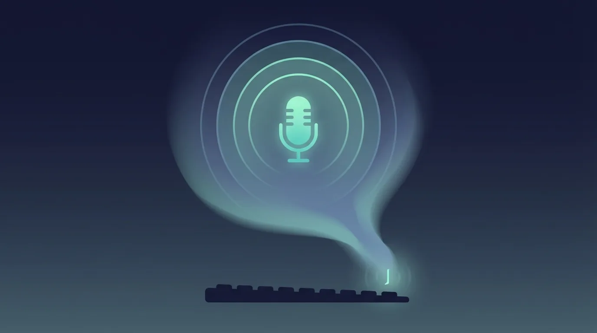
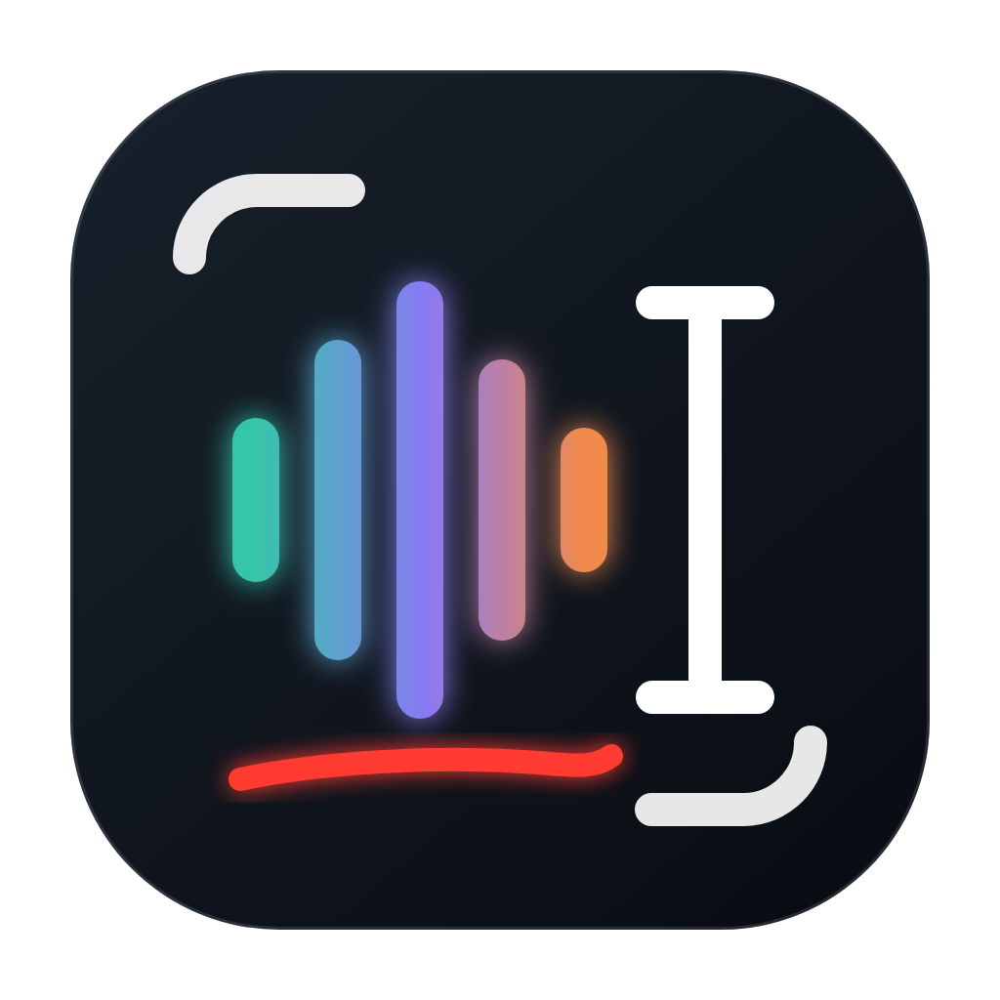

#  voice-type

Hold a key, talk, let go, and your words get typed wherever you are.

## What it is

This is push-to-talk dictation for the Mac that runs entirely on your own machine, so no cloud and no subscription. Hold F12 or Right Control and talk, a little pill comes up at the bottom of the screen with a live preview, and when you let go the text is pasted wherever you're typing. Your clipboard gets put back afterwards.

You can also draw on the screen while you talk. I spend a lot of my day reviewing UI with coding agents, and I got tired of stopping to take a screenshot, scribble an arrow on it, paste it and then start talking. So while the key is down a click leaves a ring, a straight drag an arrow, and anything else (a circle, a scribble) stays as you drew it, each with a number. When you let go, the text goes in with `[1]`, `[2]` and so on where you were talking, followed by a screenshot of each window you drew on.

It's Mac only (Apple Silicon and macOS 26) and runs whisper.cpp with the large-v3-turbo model locally on the GPU, so a short clip is typed about a third of a second after you let go.

## Get it

You'll need Xcode 27. Then:

```sh
git clone https://github.com/mikecann/voice-type.git
cd voice-type
native/scripts/build-app.sh
```

That builds Voice Type Native.app, signs it, installs it to `~/Applications`, puts the speech model in place (an 874 MB download the first time) and starts it from its own LaunchAgent, so it comes back at login and after a crash. The first time it opens a window with the permissions it needs (Accessibility, Input Monitoring and the microphone), and macOS asks for Screen Recording the first time you draw.

The script signs with my Apple Development certificate, so change `IDENTITY` at the top of it to one of yours first (`security find-identity -v -p codesigning` lists them). It has to be a real certificate rather than an ad hoc signature, otherwise macOS forgets the app's permissions every time you rebuild it.

Run the same script after a change and it restarts the app into the new build once you're not in the middle of a dictation. `voice-type-native status` shows what it's up to.

[native/README.md](native/README.md) has the rest: settings, the command line, the tests and how it all fits together.

The original Python version, which also ran on Windows, lives on in git history (last at commit 17e8220).

## More tools

You can find my other tools at [mikerosoft.app](https://mikerosoft.app).

MIT licensed.
