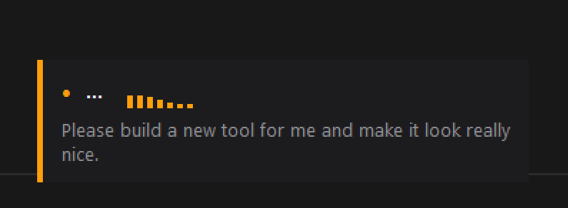

#  voice-type

Hold a key, talk, let go, and your words get typed wherever you are

Windows · macOS

<!-- media: hero

media: hero -->

## What it is

This is push-to-talk dictation that runs entirely on your own machine, so no cloud and no subscription. You hold the hotkey, a little pill appears at the bottom of the screen with a waveform and a rough preview of what you're saying, and when you let go the final text gets typed into whatever window has focus.

It uses Whisper under the hood. On an NVIDIA GPU or an Apple Silicon Mac (via MLX) it's pretty quick, and on plain CPU it drops to smaller models so it still keeps up. It also leaves your clipboard alone, which I was quite happy about.

[Watch the demo](https://youtu.be/lYjgJ8KIh-Y)



## Get it

Paste this into your AI coding agent (Claude Code, Codex, Cursor...):

> Fork https://github.com/mikecann/voice-type to my GitHub account and clone my
> fork (if I don't use GitHub, or want to keep my copy private, just clone it
> instead), then make it my own. It's one of Mike Cann's personal tools, so read
> the README first, change anything specific to his setup to suit mine, then help
> me get it running.

### Or set it up by hand

Install Git and Python 3.10+ first. On macOS you'll also need Homebrew and Xcode
Command Line Tools (`xcode-select --install`); Apple Silicon is recommended for MLX.
Whisper and optional formatter models download on first use. No API keys or `.env`
file are needed, and transcription runs locally once the models are cached.

```sh
git clone https://github.com/mikecann/voice-type.git
cd voice-type
```

On Windows, run this from PowerShell:

```powershell
powershell -ExecutionPolicy Bypass -File .\install.ps1
# Launch silently, or use Voice Type from the Start menu
wscript.exe .\voice-type.vbs
```

The installer runs `deps.ps1` and creates `C:\dev\tools\Voice Type.lnk` plus
Start menu entries named `Voice Type`, `VoiceType`, and `voice`, as in my setup.
Right-click the shortcut in `C:\dev\tools` and pin it to the taskbar.
Use `-ToolsDir 'D:\Tools'` for a different shortcut directory or `-SkipDeps` if
dependencies are already installed. Keep the clone in place, Windows shortcuts
launch its live files. NVIDIA machines also get the CUDA Python packages.

On macOS:

```bash
bash install.sh
# Launch or restart the background worker
voice-type
# Open settings
bash open-settings-mac.sh
# Diagnose startup and readiness
voice-type status
```

`install.sh` runs `setup_mac.sh`, installs `~/Applications/Voice Type.app`, and
links `voice-type` into `~/.local/bin`. Add that directory to your shell's PATH
if it isn't already there, or use `bash voice-type-mac.sh` directly. You can
choose another command directory with `bash install.sh /path/to/bin`.

The macOS worker runs from `~/Library/Application Support/Voice Type`, with
its virtual environment beside it. Logs live under `~/Library/Logs/Voice Type`.
Spotlight opens settings when you search for `Voice Type`. After editing source,
run `voice-type` again to stage the updated files and restart the worker.

The example settings and the built-in microphone preference use my **Yeti Stereo
Microphone**. Choose your microphone or **System Default** in Settings. The
example selects `large-v3-turbo`; on a CPU-only machine, choose `small.en` for
final transcription and `tiny.en` for preview. Existing settings are kept when
you reinstall.

### Permissions on macOS

`voice-type` needs a few macOS permissions to work properly:

1. `Accessibility`
   Required so it can detect the global hotkey and inject text into other apps.
2. `Microphone`
   Required so it can record your speech.
3. `Screen & System Audio Recording`
   Only needed for drawing while you talk (see below). macOS asks the first
   time you draw. Allow `Voice Type`, then restart it with `voice-type`.

If the hotkey does nothing, or transcription works but text does not paste, check:

- `System Settings` -> `Privacy & Security` -> `Accessibility`
- `System Settings` -> `Privacy & Security` -> `Microphone`

Grant access to the app that is actually running `voice-type`, usually your terminal
or the Python host it launched under.

---

## Using it

| Action | What happens |
| --- | --- |
| Hold the hotkey | Recording starts and an animated overlay appears at the bottom-centre of your monitor |
| Keep holding | Waveform bars respond to your voice and partial transcription builds up below them |
| Release the hotkey | Final transcription runs and text is pasted into the active window |
| Drag with the mouse while holding (macOS) | Draws in red on screen, and a screenshot of each window you marked is pasted after the text |
| Open settings | On Windows use the tray icon, on macOS use Spotlight `Voice Type` or `open-settings-mac.sh` |

The text is injected into whatever window had focus when you released the key,
text editors, browsers, chat apps, terminals, etc. Your clipboard is left untouched.

Hotkey by platform:

- **Windows**: Right Ctrl
- **macOS**: F12 or Right Ctrl

### Drawing while you talk (macOS)

I spend a lot of my day reviewing UI with coding agents, and I got tired of
stopping to take a screenshot, scribble an arrow on it, paste it, and then
start talking. So now the mouse becomes a pen while the hotkey is held.

Hold the key, talk, and drag on the screen to point at things. A quick click
leaves a ring, a straight drag becomes an arrow, and anything else (a circle,
a scribble) stays as you drew it. Each mark gets a little number. When you let
go, the text is pasted with `[1]`, `[2]` and so on where you were talking
when you drew each mark, and then the screenshots are pasted after it, one by
one. Marks on the same window all end up on one screenshot of it, so if you
circle three things in one app you get a single picture with 1, 2 and 3 on
it. T3 Code, Slack and Chrome web apps turn pasted images into attachments,
so that's where it's most handy.

A few details:

- Clicks and drags only turn into ink while the key is down. Moving the mouse
  without a button pressed still works as normal, and nothing reaches the app
  underneath while you draw.
- Each screenshot is just the window under the marks, with every mark you
  made on that window drawn on it. If you move or resize the window part way
  through, the marks after that get their own screenshot so the ink still
  lines up. Over bare desktop it grabs a chunk of the screen around each mark
  instead. You can make up to 10 marks per dictation.
- To keep pastes small, screenshots are shrunk so the long edge is at most
  1568 px (Claude shrinks anything bigger than that anyway) and saved as 256
  colour PNGs. That takes a typical window from about 1 MB down to under
  200 KB, and the text still looks sharp.
- If you draw but don't say anything, only the screenshots are pasted.
- Screenshots are saved in a `screenshots` folder under the application-data
  directory and deleted after 7 days. With `audio_recording_enabled` on, the
  dictation's metadata lists them too.
- It needs Screen Recording permission. The first time you draw without it,
  your words still paste, the pill says so and macOS asks. Switch on Voice
  Type under Privacy & Security > Screen & System Audio Recording, then run
  `voice-type` to restart it.
- Turn it off with **Draw on screen while holding the key** in Settings.

`debug_mark_capture.py` checks capture and paste without holding the key.
Run it with the installed runtime's Python and see the top of the file for
examples.

---

## Overlay

While recording a pill-shaped overlay appears at the **bottom-centre of the
monitor containing the focused window**:

```
┌─┬──────────────────────────────────────┐
│ │  ● REC  ▂▄█▇▄▆▂                    │
│ │  "partial transcript text..."       │
└─┴──────────────────────────────────────┘
```

| Element                      | Description                                           |
| ---------------------------- | ----------------------------------------------------- |
| Coloured accent strip (left) | Red = recording, amber = transcribing                 |
| `● REC` / `...` label        | Current state                                         |
| Waveform bars                | 7 bars that animate to your mic level in real time    |
| Partial text                 | Streaming preview, updates ~every 0.5 s as you speak |

The overlay is configured so it **never steals keyboard focus**.

---

## Settings UI

### Windows

A microphone icon sits in the system tray. Its colour reflects the current state:

| Colour    | State                  |
| --------- | ---------------------- |
| Dark grey | Idle, ready to record |
| Red       | Recording              |
| Amber     | Transcribing           |
| Very dark | Disabled               |

**Right-click menu:**

| Item                  | Description                                                        |
| --------------------- | ------------------------------------------------------------------ |
| **Enabled** ✓         | Toggle the tool on/off without killing the process                 |
| **Formatter Enabled** | Turn local transcript cleanup on/off near the top of the menu      |
| **Open Log**          | Opens `voice-type.log` in Notepad                                  |
| **Run on Startup**    | Add/remove from `HKCU\...\Run` (auto-start with Windows)           |
| **Formatter → Model** | Choose the local cleanup model, only shown when formatter is enabled |
| **Formatter → Edit System Prompt...** | Open a multiline editor for the formatter system prompt |
| **Formatter → Reset System Prompt** | Restore the built-in default formatter prompt            |
| **Exit**              | Quit cleanly                                                       |

### macOS

macOS does not currently use the Windows tray flow.

- Open settings via Spotlight by typing `Voice Type`
- Or run `bash open-settings-mac.sh`
- Click **History...** in Settings to open completed transcriptions. Clicking a
  row copies its full text to the clipboard.
- The worker itself runs in the background via `voice-type-mac.sh`
- `Run on Startup` writes a LaunchAgent that targets the stable installed
  runtime, so deleting a development worktree cannot break the next login
- `voice-type-mac.sh` waits for the control server before reporting a successful
  restart, and verifies that the app is idle with its final model ready
- Short sleep/wake cycles are detected from macOS lifecycle notifications.
  Dock/display changes are tracked, and the current default microphone is
  resolved again before the next recording.
- After a wake, Voice Type gives your chosen microphone up to 30 seconds to
  come back before falling back to the system default. It does this quietly.
  If you press the hotkey before it's ready, the overlay shows what it's
  waiting for.
- Native model loading and final transcription have watchdog deadlines. If
  MLX/Metal stops responding, Voice Type writes a thread dump and lets launchd
  restart a fresh process instead of remaining stuck on Transcribing.

## How it works

- **Hotkey handling**: Windows polls `GetAsyncKeyState(VK_RCONTROL)` at 100 Hz.
  macOS uses a native event tap for `F12` and Right Ctrl, suppressing whichever
  key is held so the system does not also handle it. Left Ctrl remains untouched.
- **Audio capture**: `sounddevice` streams 16 kHz mono float32 from the
  default microphone into a NumPy buffer.
- **Streaming preview**: a background thread transcribes accumulated audio
  every 0.5 s and updates the overlay in every output mode. Accelerated systems
  default to `large-v3-turbo`; CPU-only systems use `tiny.en`.
- **Final transcription**: on key release, the final model transcribes the
  full audio for accuracy. On Windows this is `faster-whisper` on CPU or CUDA.
  On Apple Silicon macOS, `voice-type` prefers **MLX Whisper** for supported
  models, which makes both preview and final passes much faster than the
  previous CPU-only macOS path.
- **Fast Final mode**: the accurate final model precomputes a growing
  transcript while the key is held. On release, only a short overlapping tail
  is transcribed. The transcripts are joined at a confirmed multi-word
  boundary; if Whisper revised the boundary around a pause or stutter, Voice
  Type falls back to a full pass instead of risking missing or duplicated text.
- **Text injection**: Windows injects text via `SendInput` with
  `KEYEVENTF_UNICODE`. macOS re-activates the target app and pastes with an
  `NSPasteboard` + `Cmd+V` flow that restores every clipboard item and type,
  including screenshots, files, rich text, and an empty clipboard. The old
  clipboard only comes back once the target app has actually read the text.
  If it never reads it within 2 seconds, the paste didn't land: Voice Type
  plays a sound and leaves the text on the clipboard so `Cmd+V` pastes it.
  Chromium apps (Claude, ChatGPT, Slack) read the clipboard even when no
  text box has focus, so after the read Voice Type also asks Accessibility
  what has focus. If it isn't something editable, and the app doesn't move
  the paste into a text box within half a second, the same sound plays and
  the text stays on the clipboard. When Accessibility can't tell, the paste
  is trusted.
- **Optional transcript cleanup**: for `final_only`, `hybrid`, and
  `precompute`, an optional local GGUF instruct model can lightly clean the
  final transcript before it is typed. Guardrails reject outputs that remove
  numbers, acronyms, URLs, or too much of the original wording, and the tool
  falls back to the raw transcript on validator failures, backend errors, or
  timeout. `stabilized` skips this step on purpose because it types partial
  segments before the full sentence exists.
- **Hardware-aware model design**: Apple Silicon uses one warmed MLX
  `large-v3-turbo` model for preview and final transcription, with serialized
  access when preview is enabled. CUDA uses turbo for both paths with separate
  CTranslate2 instances. CPU-only systems keep `tiny.en` for preview and
  `small.en` for the final pass.
- **Monitor detection**: each platform finds the monitor containing the
  focused window, then centres the overlay at its bottom edge.
- **Waveform animation**: the overlay canvas polls `Recorder.get_rms()` at
  30 fps, driving 7 bottom-anchored bars with a smoothed exponential moving
  average. A sine-sweep animation plays during transcription.
- **Log rotation**: on startup, if `voice-type.log` exceeds 1 MB the file
  is trimmed to the last 200 lines automatically.

---

## Performance

| Hardware | Final backend | Final model | Typical post-release delay |
| --- | --- | --- | --- |
| CPU (any) | `faster-whisper` | `small.en` | ~0.5 to 1.5 s depending on clip length |
| NVIDIA GPU (CUDA) | `faster-whisper` | `large-v3-turbo` | ~0.2 s |
| Apple Silicon | `mlx-whisper` | `small.en` / `large-v3-turbo` | much faster than the old CPU-only macOS path, with `large-v3-turbo` now feeling comfortably usable |

Windows auto-detects CUDA (`ctranslate2.get_cuda_device_count()` +
`cublas64_12.dll` load check) and falls back to CPU automatically.

On Apple Silicon, `voice-type` prefers MLX for supported preview and final
models and falls back safely if MLX is unavailable. When both settings select
`large-v3-turbo`, the preview reuses the warmed final model rather than loading
the weights twice. MLX scratch buffers are released after each transcription so
memory use returns to the loaded-model baseline instead of growing across
recordings. Larger models still have a larger baseline; choose a smaller model
in settings when memory matters more than accuracy.

On Intel Macs, expect the fallback path rather than the MLX speedup.

Models download once from HuggingFace on first use and are cached locally.

### Formatter benchmark

I benchmarked the local cleanup models on real transcript samples on this
machine after the model was warm:

| Formatter model | Typical added latency | What happened |
| --------------- | --------------------- | ------------- |
| `Qwen2.5 0.5B`  | ~0.9 to 1.7 s            | Best latency/guardrail balance, now the default |
| `Qwen2.5 1.5B`  | ~1.6 to 3.8 s            | Cleaner punctuation, but too eager to rewrite wording |
| `SmolLM2 1.7B`  | ~2.1 to 3.9 s            | Usually left the text unchanged |

That is why the formatter is **off by default**, and why the default model is
the smaller `Qwen2.5 0.5B` rather than the stronger 1.5B model.

---

## Configuration

Use the Windows tray menu or the macOS settings window for normal configuration.
The persisted settings live in `settings.json` beside the worker: in the clone
on Windows, or the installed runtime on macOS. `settings.example.json` seeds
new installs; your edited `settings.json` is ignored by Git.

Completed transcription text is also kept in a separate, durable history file
(`transcription-history.jsonl` under Voice Type's application-data directory).
Entries are retained for 30 days. Microphone audio is not saved by default.

For debugging misheard dictations, set `audio_recording_enabled` to `true` in
`settings.json` and restart Voice Type. Every captured dictation is then saved
locally in a `recordings` folder under the same application-data directory,
including silent clips and failed transcriptions. Each float WAV preserves the
samples given to the speech model. A matching JSON file holds the transcript,
actual microphone, model settings and capture timing. Recordings are kept for
30 days, with no count limit. Expired audio and matching metadata are deleted
at startup and hourly while Voice Type runs. Nothing is uploaded.

Useful keys:

| Setting              | Default          | Description |
| -------------------- | ---------------- | ----------- |
| `final_model`        | `"small.en"` / `"large-v3-turbo"` | Final transcription model. On Apple Silicon, supported values can use MLX |
| `stream_model`       | `"tiny.en"` / `"large-v3-turbo"` | Preview model. Accelerated systems default to turbo |
| `output_mode`        | `"final_only"`   | Finalise strategy |
| `microphone_name`    | `"Yeti Stereo Microphone"` | Input device selected in Settings. Choose System Default to follow the operating-system input |
| `formatter_enabled`  | `false`          | Turn local transcript cleanup on/off |
| `audio_recording_enabled` | `false`      | Save local audio and matching diagnostic metadata for 30 days |
| `draw_on_screen_enabled` | `true` on macOS | Let the mouse draw marks while the hotkey is held, and paste a screenshot of each window you marked. Ignored on Windows |
| `formatter_model`    | `"qwen2.5-0.5b"` | Local cleanup model preset |
| `corrections`        | `{...}`          | Exact phrase replacements applied after transcription |
| `vocabulary`         | `[...]`          | Names and jargon Whisper should expect, like `"Tailscale"` or `"Sammy Cam"`. They become Whisper's prompt, which also keeps capitals and punctuation on short dictations |

If you want to tweak hardcoded behaviour, edit the constants near the top of
`voice-type.py`:

| Constant | Default | Description |
| --- | --- | --- |
| `HOTKEY_VK` | `0xA3` | Windows virtual key for push-to-talk (Right Ctrl) |
| `CPU_MODEL` | `"small.en"` | Final transcription model on CPU |
| `GPU_MODEL` | `"large-v3-turbo"` | Accelerated transcription model on CUDA or MLX |
| `STREAM_MODEL` | `"tiny.en"` | CPU-only preview fallback |
| `STREAM_INTERVAL` | `0.5` | Seconds between streaming preview passes |
| `DEVICE` | `None` | Mic device (`None` = system default) |

**Common hotkey alternatives:**

| VK code | Key         |
| ------- | ----------- |
| `0xA5`  | Right Alt   |
| `0x14`  | Caps Lock   |
| `0x91`  | Scroll Lock |
| `0x7B`  | F12         |

---

## Dependencies

### Windows

Installed automatically by `deps.ps1`:

```
faster-whisper   speech-to-text engine (CTranslate2 backend)
sounddevice      microphone capture
numpy            audio buffer maths
Pillow           tray icon drawing
pystray          system tray integration
huggingface_hub  GGUF model downloads
llama-cpp-python local GGUF inference for transcript cleanup
```

### macOS

Installed automatically by `setup_mac.sh`:

```
mlx-whisper      Apple Silicon Whisper backend for preview and final transcription
faster-whisper   fallback speech-to-text engine
sounddevice      microphone capture
numpy            audio buffer maths
Pillow           overlay drawing
huggingface_hub  model downloads
llama-cpp-python local GGUF inference for transcript cleanup
pyobjc-framework-Cocoa native macOS integration
```

## Files

| File                  | Purpose                                                  |
| --------------------- | -------------------------------------------------------- |
| `voice-type.py`       | Main script: audio, tray UI, transcription, injection   |
| `speech_backends.py`  | Backend selection and the MLX Whisper adapter            |
| `text_formatter.py`   | Local LLM formatting guardrails and GGUF backend         |
| `screen_marks.py`     | Mark shapes, window choice, coordinates and `[n]` markers |
| `mark_capture.py`     | Captures each marked window and draws its marks on (macOS) |
| `appkit_ink.py`       | The live red ink overlay (macOS)                         |
| `debug_mark_capture.py` | Tries capture and paste without holding the key        |
| `benchmark_formatter.py` | Quick local benchmark for formatter model experiments |
| `tests/test_text_formatter.py` | Unit tests for formatter validation and fallback |
| `tests/test_speech_backends.py` | Unit tests for backend selection logic          |
| `voice-type.vbs`      | Silent launcher (no console window)                      |
| `voice-type.ps1`      | PowerShell launcher called by the VBS                    |
| `deps.ps1`            | Installs Python dependencies                             |
| `setup_mac.sh`        | Installs the stable macOS runtime, venv, and dependencies |
| `install-runtime-mac.sh` | Stages source into the stable macOS runtime           |
| `launch-voice-type-mac.sh` | Validated, rotating LaunchAgent entry point         |
| `voice-type-launcher.c` | Native host so Activity Monitor shows `Voice Type`    |
| `voice-type-mac.sh`   | Verified macOS restart and status script                 |
| `open-settings-mac.sh`| Opens the macOS settings window                          |
| `~/Library/Logs/Voice Type/voice-type.log` | Runtime log, auto-rotates at 1 MB |


## Development

The test dependencies don't load speech models or need a microphone:

```bash
python3 -m venv .venv
.venv/bin/python -m pip install -r requirements-test.txt
.venv/bin/python -m unittest discover -s tests -v
```

On Windows use `.venv\Scripts\python.exe` in place of `.venv/bin/python`.
CI runs the portable suite on macOS, the Windows platform tests on Windows,
and checks every PowerShell script and the shell launchers for syntax errors.
The native Spotlight packaging test is opt-in on macOS:
`VOICE_TYPE_TEST_NATIVE_APP=1 python3 -m unittest discover -s tests -p test_spotlight_app.py`.
The existing native icon conversion currently fails with `Invalid Iconset` on
this Mac; portable bundle tests use fake desktop commands instead.

After a Windows code change, use `restart.bat` to kill the old worker and
relaunch silently, then check `voice-type.log`. On macOS use `voice-type`
and inspect `voice-type status` and `~/Library/Logs/Voice Type/voice-type.log`.
Keep `com.mikerosoft.voice-type` as the macOS bundle and LaunchAgent identity
so existing permission grants and login settings still work.

## Uninstall

On Windows, exit from the tray menu, then run:

```powershell
powershell -ExecutionPolicy Bypass -File .\uninstall.ps1
```

Pass the same `-ToolsDir` if you chose a custom directory. This removes only
shortcuts and the login entry that point at this clone. Your settings, history
and models are retained. Unpin the taskbar shortcut manually if needed.

On macOS, turn off **Run on Startup** in Settings and quit the worker. Remove
the `voice-type` symlink from your command directory and move
`~/Applications/Voice Type.app` to the Trash. The installed runtime, history
and models remain available until you choose to remove them.

## More tools

You can find my other tools at [mikerosoft.app](https://mikerosoft.app).

MIT licensed.
